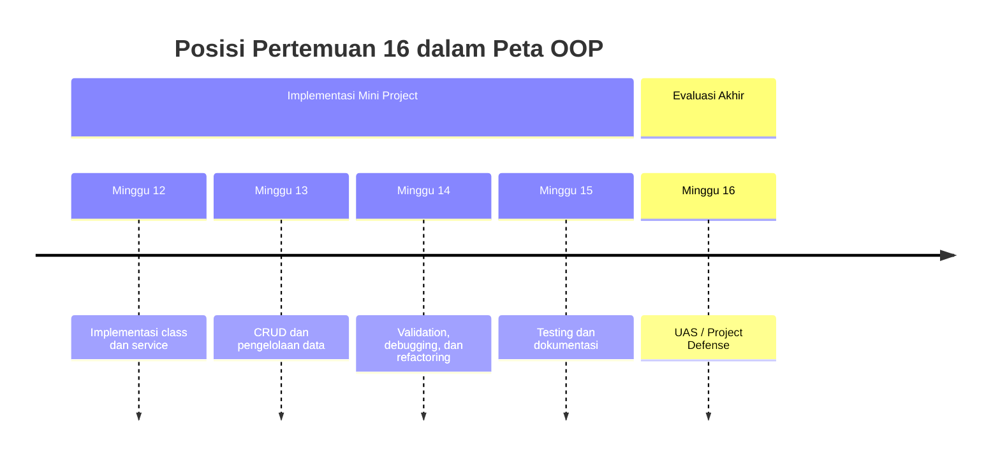
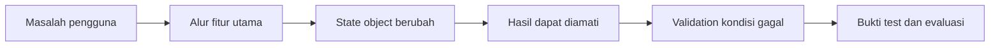
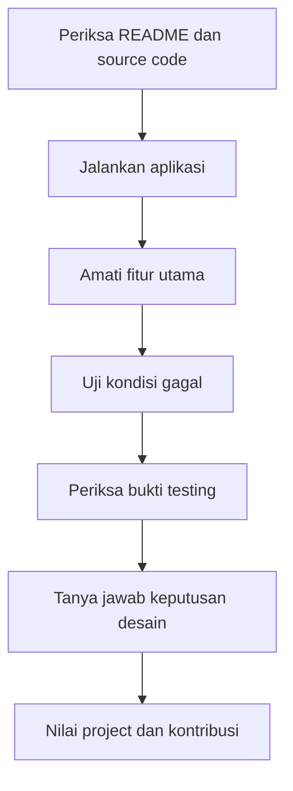

# Pertemuan 16 — UAS / Project Defense

| | |
|:--|:--|
| **Mata Kuliah** | USA-WP2360214 — Pemrograman Berorientasi Objek |
| **Pertemuan** | 16 dari 16 |
| **Tanggal** | Rabu, 30 Desember 2026 |
| **CPMK** | CPMK116 |
| **Materi** | Demo aplikasi, presentasi, tanya jawab, dan pertanggungjawaban desain OOP |
| **Model Pembelajaran** | Project Based Learning / Project Defense / Presentasi |
| **Stack** | Python 3 |

> **Catatan penting:** Pertemuan 16 merupakan UAS / Project Defense. Tim menunjukkan aplikasi yang telah dibuat, menjelaskan keputusan desain, memperlihatkan bukti testing, serta menjawab pertanyaan tentang class, relasi object, validation, dan batasan aplikasi.

---

## Daftar Isi

- [Pertemuan 16 — UAS / Project Defense](#pertemuan-16--uas--project-defense)
  - [Daftar Isi](#daftar-isi)
  - [1. Keterkaitan Pertemuan dengan RPS OBE](#1-keterkaitan-pertemuan-dengan-rps-obe)
  - [2. Capaian Pembelajaran Pertemuan](#2-capaian-pembelajaran-pertemuan)
  - [3. Pemantik Kasus: Project Harus Dipertanggungjawabkan](#3-pemantik-kasus-project-harus-dipertanggungjawabkan)
  - [4. Komponen Project Defense](#4-komponen-project-defense)
  - [5. Alur Demo Aplikasi](#5-alur-demo-aplikasi)
  - [6. Pertanggungjawaban Desain OOP](#6-pertanggungjawaban-desain-oop)
  - [7. Bukti Testing dan Dokumentasi](#7-bukti-testing-dan-dokumentasi)
  - [8. Strategi Menjawab Pertanyaan](#8-strategi-menjawab-pertanyaan)
  - [9. Rubrik Penilaian UAS](#9-rubrik-penilaian-uas)
  - [10. Studi Kasus Project Defense](#10-studi-kasus-project-defense)
  - [11. Latihan Terbimbing](#11-latihan-terbimbing)
  - [12. Aktivitas Kelompok](#12-aktivitas-kelompok)
  - [13. Latihan Individu](#13-latihan-individu)
  - [14. Pemanfaatan AI sebagai Coding Assistant](#14-pemanfaatan-ai-sebagai-coding-assistant)
    - [15. Soal UAS / Project Defense](#15-soal-uas--project-defense)
    - [16. Kuis Formatif](#16-kuis-formatif)
    - [17. Asesmen dan Penugasan](#17-asesmen-dan-penugasan)
    - [18. Referensi dan Kode Praktikum](#18-referensi-dan-kode-praktikum)

---

## 1. Keterkaitan Pertemuan dengan RPS OBE

Pertemuan 16 mendukung **CPMK116** dan `SUB-CPMK11602` pada RPS:

> Mahasiswa mampu mempresentasikan, mengevaluasi, dan mempertanggungjawabkan aplikasi OOP yang telah dikembangkan.

Project Defense menggabungkan hasil Pertemuan 12–15: implementasi class, CRUD, validation, exception handling, refactoring, testing, dan dokumentasi.



---

## 2. Capaian Pembelajaran Pertemuan

Setelah mengikuti pertemuan ini, mahasiswa mampu:

| No. | Kemampuan | Indikator |
| :-: | --------- | --------- |
| 1 | Mendemonstrasikan aplikasi | Menjalankan fitur utama berdasarkan skenario yang telah disiapkan |
| 2 | Menjelaskan desain OOP | Menguraikan class, attribute, method, relasi, dan tanggung jawab object |
| 3 | Mempertanggungjawabkan implementasi | Menjelaskan alasan teknis untuk validation, exception, CRUD, dan testing |
| 4 | Mengevaluasi keterbatasan | Menyebutkan batasan aplikasi dan rencana pengembangan yang realistis |
| 5 | Menjawab pertanyaan teknis | Memberikan jawaban berdasarkan kode, hasil test, dan dokumentasi |

---

## 3. Pemantik Kasus: Project Harus Dipertanggungjawabkan

Aplikasi yang selesai dibuat perlu dijelaskan kepada orang lain. Tim harus menunjukkan hubungan antara kebutuhan, rancangan, kode, hasil testing, dan demo.

Pertanyaan pemantik:

1. Masalah apa yang diselesaikan oleh aplikasi?
2. Mengapa class tersebut dipisahkan menjadi beberapa object?
3. Di mana validation dan aturan bisnis diterapkan?
4. Bagaimana tim membuktikan fitur utama bekerja?
5. Apa keterbatasan aplikasi saat ini?

Pertanggungjawaban bukan hanya menjalankan program. Setiap anggota perlu memahami bagian project yang dipresentasikan dan dapat menjelaskan alasan teknisnya.

---

## 4. Komponen Project Defense

Project Defense terdiri atas beberapa komponen berikut:

| Komponen | Isi | Bukti |
| -------- | --- | ----- |
| Produk aplikasi | Program OOP yang dapat dijalankan | Source code dan struktur project |
| Demo | Skenario fitur utama dan kondisi gagal | Keluaran program atau tampilan aplikasi |
| Presentasi | Masalah, solusi, desain, dan evaluasi | Slide atau dokumen presentasi |
| Testing | Skenario dan hasil pengujian | Test case dan output `unittest` |
| Tanya jawab | Penjelasan keputusan teknis | Jawaban berdasarkan kode |
| Kontribusi | Peran setiap anggota | Catatan pembagian tugas |

Sebelum ujian, pastikan semua bukti memakai nama class, fitur, dan instruksi yang sama dengan source code.

---

## 5. Alur Demo Aplikasi

Gunakan alur demo yang pendek dan dapat diulang:

1. jelaskan tujuan aplikasi;
2. tampilkan kondisi awal atau menu utama;
3. jalankan satu alur utama dari input sampai hasil;
4. tunjukkan satu validation atau kondisi gagal;
5. tampilkan bukti testing;
6. jelaskan hasil dan batasan.



Siapkan data demo yang tidak bergantung pada koneksi eksternal. Jalankan program dari kondisi awal sebelum presentasi agar langkah demo dapat diulang.

---

## 6. Pertanggungjawaban Desain OOP

Jelaskan setiap bagian berdasarkan tanggung jawabnya:

| Pertanyaan | Hal yang perlu dijelaskan |
| ---------- | ------------------------- |
| Mengapa class ini ada? | Entitas atau tanggung jawab yang direpresentasikan |
| Apa attribute pentingnya? | Data yang diperlukan untuk menjaga state object |
| Apa method utamanya? | Operasi yang menjadi tanggung jawab class |
| Bagaimana object berinteraksi? | Pemanggilan method dan relasi antar-object |
| Di mana aturan data dijaga? | `property`, validation, atau service |
| Mengapa struktur ini dipilih? | Alasan teknis dan konsekuensi pilihan |

Contoh jawaban yang baik menyebutkan lokasi perilaku secara umum, aturan yang dijaga, dan hasil yang dapat diamati. Hindari jawaban yang hanya menyebut nama file tanpa menjelaskan tanggung jawab kode.

---

## 7. Bukti Testing dan Dokumentasi

Tampilkan bukti yang relevan:

- daftar test case dengan expected result;
- hasil test runner;
- contoh jalur berhasil;
- contoh validation atau exception;
- README dengan instruksi yang dapat diikuti;
- diagram class atau gambaran struktur module;
- daftar batasan dan rencana pengembangan.

Bukti test perlu menjawab tiga hal: apa yang diuji, hasil yang diharapkan, dan hasil aktual. Jika sebuah test gagal, jelaskan penyebab dan keputusan perbaikannya secara jujur.

---

## 8. Strategi Menjawab Pertanyaan

Gunakan urutan berikut saat menjawab:

1. dengarkan pertanyaan sampai selesai;
2. sebutkan bagian kode atau fitur yang terkait;
3. jelaskan alasan teknisnya;
4. berikan contoh hasil atau skenario;
5. akui batasan jika fitur belum tersedia;
6. usulkan perbaikan yang realistis.

Contoh pertanyaan penguji:

- Mengapa collection disimpan pada dictionary?
- Mengapa method tertentu mengembalikan `False`, bukan exception?
- Bagaimana program menolak identifier duplikat?
- Apa dampak jika validation dihapus?
- Test apa yang membuktikan perubahan state object?
- Bagaimana class dapat dikembangkan tanpa mengubah program utama?

---

## 9. Rubrik Penilaian UAS

| Komponen | Bobot | Indikator |
| --------- | :---: | --------- |
| Fungsionalitas aplikasi | 30% | Fitur utama berjalan sesuai kebutuhan |
| Penerapan OOP | 20% | Class, object, tanggung jawab, dan relasi digunakan secara tepat |
| Testing dan evaluasi | 15% | Test case, test otomatis, dan hasil evaluasi tersedia |
| Dokumentasi | 10% | Instruksi, struktur, batasan, dan referensi jelas |
| Presentasi dan demo | 15% | Alur teratur, bukti sesuai, dan demo dapat diulang |
| Tanya jawab | 10% | Jawaban teknis akurat dan sesuai implementasi |

Penilaian individu dapat mempertimbangkan kemampuan menjelaskan kontribusi dan bagian kode yang dikerjakan.

---

## 10. Studi Kasus Project Defense

Sebuah tim mempresentasikan Sistem Peminjaman Ruang. Mereka menunjukkan diagram class, alur Create dan Update, test validation, serta kondisi ruang aktif yang tidak dapat dihapus.

Urutan evaluasi:



Tim harus dapat menjelaskan hubungan antara kebutuhan pengguna, class `Ruang`, class `Peminjaman`, service, dan test case. Jika ada fitur yang belum tersedia, fitur tersebut dicatat sebagai batasan.

---

## 11. Latihan Terbimbing

Gunakan contoh checklist pada [`../code/pertemuan-16/defense_checklist.py`](../code/pertemuan-16/defense_checklist.py).

```bash
python3 ../code/pertemuan-16/defense_checklist.py
```

Kemudian lengkapi scaffold pada [`../code/pertemuan-16/latihan_defense.py`](../code/pertemuan-16/latihan_defense.py).

```bash
python3 ../code/pertemuan-16/latihan_defense.py
```

Langkah latihan:

1. tulis tujuan dan pengguna aplikasi;
2. pilih dua fitur utama untuk demo;
3. hubungkan setiap fitur dengan class dan method;
4. siapkan satu kondisi gagal;
5. catat bukti testing dan batasan;
6. lakukan simulasi tanya jawab.

---

## 12. Aktivitas Kelompok

1. Bagikan peran presenter, demonstrator, penjelas desain, dan pencatat pertanyaan.
2. Susun demo maksimal 10 menit.
3. Tunjukkan satu skenario berhasil dan satu kondisi gagal.
4. Minta kelompok lain memberikan tiga pertanyaan teknis.
5. Perbaiki jawaban yang belum didukung oleh source code atau hasil test.
6. Finalisasi bukti presentasi dan pembagian kontribusi.

---

## 13. Latihan Individu

1. Jelaskan tanggung jawab tiga class utama pada project.
2. Pilih satu method dan jelaskan input, proses, output, serta kondisi gagalnya.
3. Tunjukkan satu test yang membuktikan perubahan state object.
4. Tulis dua keterbatasan aplikasi dan rencana perbaikannya.
5. Latih jawaban untuk minimal lima pertanyaan desain OOP.
6. Catat kontribusi pribadi secara jujur dan dapat diverifikasi.

---

## 14. Pemanfaatan AI sebagai Coding Assistant

**AI assistant (GitHub Copilot, ChatGPT, Claude, Gemini) boleh dipakai — dengan cara yang benar:**

**✅ Gunakan AI untuk:**

- Membantu menyusun daftar pertanyaan latihan defense.
- Mereview kejelasan README dan urutan presentasi.
- Menjelaskan istilah OOP yang masih belum dipahami.
- Membantu merangkum hasil testing setelah Anda memverifikasinya.

**❌ Hindari penggunaan AI untuk:**

- Membuat jawaban defense yang tidak sesuai dengan source code.
- Mengklaim fitur yang belum dibuat atau test yang belum dijalankan.
- Menyerahkan presentasi tanpa memahami keputusan desain.
- Memasukkan data pribadi anggota tim atau source code sensitif ke dalam prompt.

**Etika di kelas ini:**

1. Anda wajib dapat menjelaskan kode, testing, dan keputusan desain yang dipresentasikan.
2. Cantumkan penggunaan bantuan AI pada refleksi project. Contoh:

   ```text
   Bantuan: GitHub Copilot — menyusun pertanyaan latihan tentang relasi class.
   ```

3. AI digunakan sebagai alat bantu pembelajaran. Anda tetap bertanggung jawab atas keaslian, ketepatan, pengujian, dan penjelasan project.

---

## 15. Soal UAS / Project Defense

Kerjakan project sesuai [Soal UAS Pertemuan 16](./02-Soal-UAS-Pertemuan-16.md). Dokumen tersebut menjelaskan tema, fitur wajib, deliverables, format testing, alur defense, contoh pertanyaan, rubrik, dan checklist pengumpulan.

## 16. Kuis Formatif

Kerjakan [Quiz Pertemuan 16](./02-Quiz-Pertemuan-16.md) untuk menguji kesiapan demo, pertanggungjawaban desain, bukti testing, dan evaluasi project.

---

## 17. Asesmen dan Penugasan

| Komponen | Bentuk | Keterangan |
| --------- | ------ | ---------- |
| Produk aplikasi | Source code | Aplikasi OOP dapat dijalankan dan memiliki fitur utama |
| Demo | Praktik | Menunjukkan alur berhasil dan kondisi gagal |
| Presentasi | Lisan dan visual | Menjelaskan masalah, solusi, desain, dan evaluasi |
| Tanya jawab | UAS / defense | Mempertanggungjawabkan keputusan teknis |
| Dokumentasi | README dan bukti test | Instruksi, test case, hasil, dan batasan |

Checklist sebelum UAS:

- [ ] Source code dan README berada pada versi terakhir.
- [ ] Program dapat dijalankan dari kondisi awal.
- [ ] Test utama sudah dijalankan.
- [ ] Demo memiliki data uji yang siap digunakan.
- [ ] Setiap anggota memahami class dan kontribusinya.
- [ ] Batasan aplikasi dijelaskan secara jujur.

---

## 18. Referensi dan Kode Praktikum

Referensi:

- [Python Docs — Classes](https://docs.python.org/3/tutorial/classes.html)
- [Python Docs — unittest](https://docs.python.org/3/library/unittest.html)
- [Python Docs — Documentation](https://docs.python.org/3/tutorial/modules.html#packages)
- [PEP 8 — Style Guide for Python Code](https://peps.python.org/pep-0008/)

Kode praktikum:

- [`../code/pertemuan-16/defense_checklist.py`](../code/pertemuan-16/defense_checklist.py) — contoh checklist kesiapan project defense.
- [`../code/pertemuan-16/latihan_defense.py`](../code/pertemuan-16/latihan_defense.py) — scaffold latihan evaluasi dan pertanggungjawaban project.
