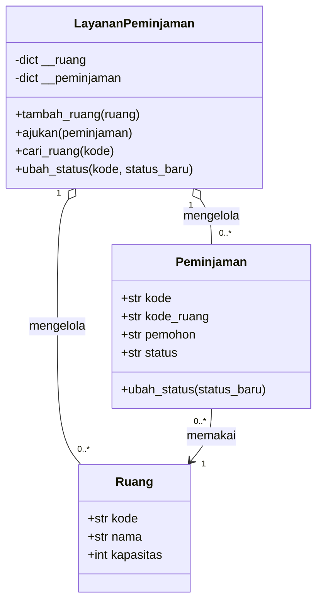

# Template Penyelesaian UAS Pertemuan 16 — Project Defense

> Salin template ini ke dalam folder project sebagai `docs/penyelesaian-uas.md`, lalu lengkapi setiap bagian. Gunakan nama class, method, file, dan hasil test yang benar-benar ada pada project Anda.
>
> Contoh di bawah menggunakan tema **Sistem Peminjaman Ruang**. Sesuaikan seluruh contoh dengan project kelompok Anda.

## 1. Identitas Project

| Keterangan | Isi |
| ---------- | --- |
| Nama project | |
| Tema aplikasi | |
| Nama kelompok | |
| Anggota | |
| Repository atau folder project | |
| Python yang digunakan | |

**Contoh pengisian:**

| Keterangan | Isi |
| ---------- | --- |
| Nama project | Sistem Peminjaman Ruang |
| Tema aplikasi | Pengelolaan ruang dan pengajuan peminjaman |
| Nama kelompok | Kelompok 2 |
| Anggota | Nadia, Bima, Sari |
| Repository atau folder project | `project-peminjaman-ruang/` |
| Python yang digunakan | Python 3.12 |

## 2. Masalah dan Tujuan

### 2.1 Masalah yang diselesaikan

Tuliskan masalah yang menjadi dasar project.

> Jawaban:
>
>

**Contoh jawaban:** Aplikasi membantu staf akademik mencatat ruang, menerima pengajuan peminjaman, dan mengubah status pengajuan. Sebelum aplikasi dibuat, pencatatan dilakukan pada daftar terpisah sehingga kode ruang dapat tertukar dan status pengajuan sulit dilacak.

### 2.2 Pengguna sasaran

Tuliskan pengguna yang akan memakai aplikasi.

> Jawaban:
>
>

**Contoh jawaban:** Pengguna sasaran adalah staf akademik yang mengelola ruang dan mahasiswa atau dosen yang mengajukan peminjaman.

### 2.3 Tujuan aplikasi

Tuliskan hasil yang ingin dicapai oleh aplikasi.

> Jawaban:
>
>

**Contoh jawaban:** Aplikasi bertujuan menyediakan pengelolaan data ruang dan pengajuan yang memiliki identifier, validation, status, dan riwayat perubahan yang dapat diperiksa selama program berjalan.

## 3. Kebutuhan dan Aturan Bisnis

### 3.1 Kebutuhan fungsional

| ID | Kebutuhan | Status implementasi |
| -- | --------- | ------------------- |
| KF-01 | | |
| KF-02 | | |
| KF-03 | | |

**Contoh pengisian:**

| ID | Kebutuhan | Status implementasi |
| -- | --------- | ------------------- |
| KF-01 | Staf dapat menambahkan ruang baru | Selesai |
| KF-02 | Pengguna dapat mencari pengajuan berdasarkan kode | Selesai |
| KF-03 | Staf dapat mengubah status pengajuan | Selesai |

### 3.2 Aturan bisnis dan validation

| ID | Aturan | Lokasi penerapan | Skenario penolakan |
| -- | ------ | ---------------- | ------------------ |
| AB-01 | | | |
| AB-02 | | | |
| AB-03 | | | |

**Contoh pengisian:**

| ID | Aturan | Lokasi penerapan | Skenario penolakan |
| -- | ------ | ---------------- | ------------------ |
| AB-01 | Kode ruang harus unik | `LayananPeminjaman.tambah_ruang()` | Kode `R001` sudah digunakan |
| AB-02 | Kapasitas harus integer positif | `Ruang.__init__()` | Kapasitas `0` ditolak |
| AB-03 | Ruang dengan pengajuan aktif tidak dapat dihapus | `LayananPeminjaman.hapus_ruang()` | Ruang yang dipakai `P001` ditolak |

## 4. Perancangan OOP

### 4.1 Daftar class

| Class | Tanggung jawab | Attribute utama | Method utama |
| ----- | -------------- | --------------- | ------------ |
| | | | |
| | | | |
| | | | |

**Contoh pengisian:**

| Class | Tanggung jawab | Attribute utama | Method utama |
| ----- | -------------- | --------------- | ------------ |
| `Ruang` | Menyimpan data dan validation ruang | `kode`, `nama`, `kapasitas` | `__init__()`, `__str__()` |
| `Peminjaman` | Menyimpan pengajuan dan status | `kode`, `kode_ruang`, `pemohon`, `status` | `ubah_status()` |
| `LayananPeminjaman` | Mengelola collection dan aturan antar-object | `__ruang`, `__peminjaman` | `tambah_ruang()`, `ajukan()`, `ubah_status()` |

### 4.2 Relasi antar-class

Jelaskan hubungan antar-class dan urutan interaksi object pada fitur utama.

> Jawaban:
>
>

**Contoh jawaban:** `LayananPeminjaman` menyimpan object `Ruang` dan `Peminjaman`. Saat pengajuan dibuat, service memeriksa apakah kode ruang tersedia. `Peminjaman` memiliki status sendiri, sedangkan service mengatur hubungan pengajuan dengan ruang.

### 4.3 Diagram class

Sisipkan diagram class atau tautkan file diagram.

```text
[Tempatkan diagram class di sini]
```

**Contoh Mermaid:**



**Contoh keterangan diagram:** `LayananPeminjaman` mengelola banyak `Ruang` dan `Peminjaman`. Setiap `Peminjaman` menyimpan `kode_ruang` yang merujuk pada satu `Ruang`.

Ganti class, attribute, method, dan relasi pada contoh tersebut sesuai dengan source code project Anda. Diagram harus menggambarkan implementasi yang benar-benar dikumpulkan.

## 5. Implementasi Fitur Utama

### 5.1 Fitur 1: [Nama fitur]

- Input:
- Class dan method yang digunakan:
- Proses utama:
- Output:
- Kondisi gagal:

**Contoh pengisian Fitur 1:**

- Input: kode `R001`, nama `Lab 1`, kapasitas `30`.
- Class dan method yang digunakan: `Ruang` dan `LayananPeminjaman.tambah_ruang()`.
- Proses utama: object dibuat, divalidasi, lalu disimpan pada dictionary service.
- Output: pesan ruang berhasil ditambahkan.
- Kondisi gagal: kode sudah digunakan atau kapasitas tidak positif.

### 5.2 Fitur 2: [Nama fitur]

- Input:
- Class dan method yang digunakan:
- Proses utama:
- Output:
- Kondisi gagal:

**Contoh pengisian Fitur 2:**

- Input: kode pengajuan `P001`.
- Class dan method yang digunakan: `LayananPeminjaman.cari_peminjaman()`.
- Proses utama: service mencari object berdasarkan identifier.
- Output: data pengajuan ditampilkan.
- Kondisi gagal: kode `P999` tidak ditemukan.

### 5.3 Fitur 3: [Nama fitur]

- Input:
- Class dan method yang digunakan:
- Proses utama:
- Output:
- Kondisi gagal:

**Contoh pengisian Fitur 3:**

- Input: kode `P001`, status baru `disetujui`.
- Class dan method yang digunakan: `Peminjaman.ubah_status()` melalui service.
- Proses utama: status diperiksa terhadap daftar status valid lalu state object diubah.
- Output: status pengajuan menjadi `disetujui`.
- Kondisi gagal: status berada di luar daftar yang diizinkan.

## 6. Test Case dan Hasil Testing

Isi `Actual result` setelah test benar-benar dijalankan.

| ID | Skenario | Kondisi awal | Input | Expected result | Actual result | Status |
| -- | -------- | ------------ | ----- | --------------- | ------------- | ------ |
| TC-01 | Create berhasil | | | | | |
| TC-02 | Read atau pencarian | | | | | |
| TC-03 | Update berhasil | | | | | |
| TC-04 | Delete atau penolakan Delete | | | | | |
| TC-05 | Validation gagal | | | | | |
| TC-06 | Exception atau aturan bisnis gagal | | | | | |

**Contoh pengisian:**

| ID | Skenario | Kondisi awal | Input | Expected result | Actual result | Status |
| -- | -------- | ------------ | ----- | --------------- | ------------- | ------ |
| TC-01 | Create berhasil | Collection kosong | `R001`, kapasitas `30` | Ruang tersimpan | Ruang tersimpan | Lulus |
| TC-02 | Read pengajuan | `P001` tersedia | Cari `P001` | Object dikembalikan | Object dikembalikan | Lulus |
| TC-03 | Update status | Status `diajukan` | `disetujui` | Status berubah | Status berubah | Lulus |
| TC-04 | Delete ditolak | Ruang dipakai `P001` | Hapus `R001` | Operasi ditolak | Mengembalikan `False` | Lulus |
| TC-05 | Validation gagal | Belum ada object | Kapasitas `0` | `ValueError` | `ValueError` | Lulus |
| TC-06 | Kode duplikat | `R001` tersedia | Tambah `R001` lagi | `DataDuplikatError` | Exception terjadi | Lulus |

### 6.1 Perintah menjalankan test

```bash
[Tuliskan perintah yang digunakan]
```

### 6.2 Ringkasan hasil test

- Jumlah test:
- Test lulus:
- Test gagal:
- Perbaikan yang dilakukan setelah testing:

**Contoh ringkasan:**

- Jumlah test: 6
- Test lulus: 6
- Test gagal: 0
- Perbaikan yang dilakukan setelah testing: menambahkan validation kapasitas dan pemeriksaan kode ruang duplikat.

## 7. Dokumentasi dan Cara Menjalankan

### 7.1 Struktur project

```text
[Tuliskan struktur folder project]
```

**Contoh pengisian:**

```text
project-peminjaman-ruang/
├── README.md
├── aplikasi.py
├── domain.py
├── layanan.py
├── tests/
│   └── test_peminjaman.py
└── docs/
    ├── diagram-class.md
    ├── test-case.md
    └── penyelesaian-uas.md
```

### 7.2 Langkah menjalankan aplikasi

1. 
2. 
3. 

**Contoh langkah:**

1. Buka terminal pada folder project.
2. Jalankan `python3 aplikasi.py`.
3. Pilih menu atau ikuti skenario penggunaan pada README.

### 7.3 Langkah menjalankan test

1. 
2. 

**Contoh langkah:**

1. Buka terminal pada folder project.
2. Jalankan `python3 -m unittest discover -s tests -v`.

### 7.4 Contoh kode berdasarkan struktur project

Contoh berikut menunjukkan hubungan antara file, class, service, program utama, dan test. Sesuaikan nama file serta kode dengan project Anda.

Contoh project lengkap tersedia pada [folder `code/pertemuan-16/contoh_project/`](../code/pertemuan-16/contoh_project/):

- [README contoh project](../code/pertemuan-16/contoh_project/README.md)
- [domain.py](../code/pertemuan-16/contoh_project/domain.py)
- [layanan.py](../code/pertemuan-16/contoh_project/layanan.py)
- [aplikasi.py](../code/pertemuan-16/contoh_project/aplikasi.py)
- [tests/test_peminjaman.py](../code/pertemuan-16/contoh_project/tests/test_peminjaman.py)

#### `domain.py`

```python
"""Class domain untuk sistem peminjaman ruang."""


class Ruang:
    """Merepresentasikan ruang yang dapat dipinjam."""

    def __init__(self, kode, nama, kapasitas):
        if not kode or not nama:
            raise ValueError("Kode dan nama ruang wajib diisi")
        if not isinstance(kapasitas, int) or kapasitas <= 0:
            raise ValueError("Kapasitas harus bilangan bulat positif")
        self.kode = kode
        self.nama = nama
        self.kapasitas = kapasitas


class Peminjaman:
    """Merepresentasikan pengajuan peminjaman ruang."""

    STATUS_VALID = {"diajukan", "disetujui", "ditolak"}

    def __init__(self, kode, kode_ruang, pemohon):
        if not kode or not kode_ruang or not pemohon:
            raise ValueError("Kode dan pemohon wajib diisi")
        self.kode = kode
        self.kode_ruang = kode_ruang
        self.pemohon = pemohon
        self.status = "diajukan"

    def ubah_status(self, status_baru):
        if status_baru not in self.STATUS_VALID:
            raise ValueError("Status peminjaman tidak valid")
        self.status = status_baru
```

#### `layanan.py`

```python
"""Service untuk mengelola object peminjaman ruang."""

from domain import Peminjaman, Ruang


class DataDuplikatError(Exception):
    """Exception untuk identifier yang sudah digunakan."""


class LayananPeminjaman:
    """Mengelola collection ruang dan pengajuan."""

    def __init__(self):
        self.__ruang = {}
        self.__peminjaman = {}

    def tambah_ruang(self, ruang):
        if ruang.kode in self.__ruang:
            raise DataDuplikatError(f"Kode ruang {ruang.kode} sudah digunakan")
        self.__ruang[ruang.kode] = ruang

    def cari_ruang(self, kode):
        return self.__ruang.get(kode)

    def ajukan(self, peminjaman):
        if peminjaman.kode in self.__peminjaman:
            raise DataDuplikatError(
                f"Kode peminjaman {peminjaman.kode} sudah digunakan"
            )
        if peminjaman.kode_ruang not in self.__ruang:
            raise ValueError("Ruang belum terdaftar")
        self.__peminjaman[peminjaman.kode] = peminjaman

    def cari_peminjaman(self, kode):
        return self.__peminjaman.get(kode)

    def ubah_status(self, kode, status_baru):
        peminjaman = self.cari_peminjaman(kode)
        if peminjaman is None:
            return False
        peminjaman.ubah_status(status_baru)
        return True


def buat_data_awal():
    """Membuat service dengan satu ruang contoh."""
    layanan = LayananPeminjaman()
    layanan.tambah_ruang(Ruang("R001", "Lab 1", 30))
    return layanan
```

#### `aplikasi.py`

```python
"""Program utama sederhana untuk demo peminjaman ruang."""

from domain import Peminjaman
from layanan import buat_data_awal


def jalankan_demo():
    """Menjalankan satu skenario pengajuan dan perubahan status."""
    layanan = buat_data_awal()
    pengajuan = Peminjaman("P001", "R001", "Nadia")
    layanan.ajukan(pengajuan)
    layanan.ubah_status("P001", "disetujui")
    hasil = layanan.cari_peminjaman("P001")
    print(f"{hasil.kode}: {hasil.status}")


# === Program utama ===
if __name__ == "__main__":
    jalankan_demo()
```

#### `tests/test_peminjaman.py`

```python
"""Unit test untuk domain dan service peminjaman ruang."""

import unittest

from domain import Peminjaman, Ruang
from layanan import DataDuplikatError, buat_data_awal


class TestPeminjaman(unittest.TestCase):
    """Menguji pembuatan object dan perubahan status."""

    def test_ruang_valid(self):
        ruang = Ruang("R001", "Lab 1", 30)
        self.assertEqual(ruang.kapasitas, 30)

    def test_kapasitas_tidak_valid(self):
        with self.assertRaises(ValueError):
            Ruang("R001", "Lab 1", 0)

    def test_pengajuan_dan_update_status(self):
        layanan = buat_data_awal()
        layanan.ajukan(Peminjaman("P001", "R001", "Nadia"))
        berhasil = layanan.ubah_status("P001", "disetujui")
        self.assertTrue(berhasil)
        self.assertEqual(layanan.cari_peminjaman("P001").status, "disetujui")

    def test_kode_pengajuan_duplikat(self):
        layanan = buat_data_awal()
        layanan.ajukan(Peminjaman("P001", "R001", "Nadia"))
        pengajuan_duplikat = Peminjaman("P001", "R001", "Bima")
        with self.assertRaises(DataDuplikatError):
            layanan.ajukan(pengajuan_duplikat)


if __name__ == "__main__":
    unittest.main(verbosity=2)
```

Contoh ini dapat dijalankan dari folder project dengan:

```bash
python3 aplikasi.py
python3 -m unittest discover -s tests -v
```

Output dan jumlah test pada project Anda dapat berbeda. Tuliskan hasil aktual setelah kode benar-benar dijalankan.

## 8. Skenario Demo

### 8.1 Skenario berhasil

1. 
2. 
3. 

Expected result:

> 

### 8.2 Skenario kondisi gagal

1. 
2. 
3. 

Expected result:

> 

### 8.3 Data yang disiapkan

| Data | Nilai |
| ---- | ----- |
| | |
| | |

## 9. Pembagian Presentasi dan Kontribusi

| Anggota | Bagian presentasi | Kontribusi kode atau dokumen |
| ------- | ----------------- | ---------------------------- |
| | | |
| | | |
| | | |

**Contoh pengisian:**

| Anggota | Bagian presentasi | Kontribusi kode atau dokumen |
| ------- | ----------------- | ---------------------------- |
| Nadia | Masalah, tujuan, dan demo Create | Class `Ruang` dan README |
| Bima | Diagram class dan demo Update | Class `Peminjaman` dan service |
| Sari | Testing dan kondisi gagal | `tests/test_peminjaman.py` dan tabel test case |

## 10. Batasan dan Rencana Pengembangan

### 10.1 Batasan aplikasi

1. 
2. 

**Contoh batasan:**

1. Data hanya tersimpan selama program berjalan.
2. Aplikasi belum memiliki autentikasi pengguna.

### 10.2 Rencana pengembangan

1. 
2. 

**Contoh rencana pengembangan:**

1. Menambahkan database melalui class repository agar data tetap tersimpan.
2. Menambahkan role pengguna untuk membatasi operasi administratif.

Jelaskan alasan teknis untuk setiap rencana pengembangan.

## 11. Refleksi Pemahaman

### 11.1 Keputusan desain yang paling penting

> Jawaban:
>
>

**Contoh jawaban:** Keputusan penting adalah memisahkan object domain dari service. `Ruang` dan `Peminjaman` menyimpan state serta aturan masing-masing, sedangkan service menangani collection dan hubungan antar-object. Dengan pembagian ini, validation object tidak bercampur dengan alur pengelolaan data.

### 11.2 Kesalahan atau kendala yang ditemukan

> Jawaban:
>
>

**Contoh jawaban:** Pada pengujian awal, kode ruang duplikat menggantikan data lama. Kami memperbaikinya dengan pemeriksaan identifier sebelum object disimpan, lalu menambahkan test `DataDuplikatError`.

### 11.3 Bantuan AI yang digunakan

Tuliskan tool AI, tujuan penggunaan, dan verifikasi yang dilakukan.

| Tool | Tujuan penggunaan | Verifikasi mahasiswa |
| ---- | ----------------- | -------------------- |
| | | |

**Contoh pengisian:**

| Tool | Tujuan penggunaan | Verifikasi mahasiswa |
| ---- | ----------------- | -------------------- |
| GitHub Copilot | Memahami penggunaan `assertRaises` | Membaca dokumentasi, menyesuaikan test, lalu menjalankan test hingga hasil sesuai expected result |

## 12. Checklist Akhir

- [ ] Semua bagian template sudah diisi.
- [ ] Nama class dan method sesuai source code.
- [ ] Minimal enam test case memiliki hasil aktual.
- [ ] Minimal empat test otomatis sudah dijalankan.
- [ ] Diagram class sesuai implementasi.
- [ ] README dan instruksi eksekusi sudah diuji.
- [ ] Demo berhasil dan kondisi gagal sudah dilatih.
- [ ] Setiap anggota memahami kontribusinya.
- [ ] Batasan aplikasi ditulis secara jujur.
